<p align="center">
  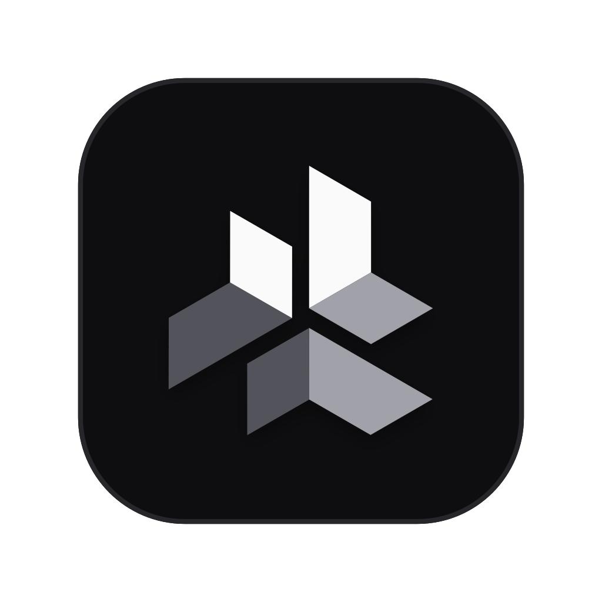
</p>

<h1 align="center">Tether</h1>

<p align="center">
  <b>Let your coding agents run. Never let go.</b><br />
  A local workbench that runs Claude Code, Codex, OpenCode and local models as a crew,<br />
  each run in its own git worktree, checked by gates, and paused for you when it matters.
</p>

<p align="center">
  <a href="https://tether.tusharcs0112.workers.dev">Website</a> ·
  <a href="https://tether.tusharcs0112.workers.dev/docs">Docs</a> ·
  <a href="docs/reference.md">Full reference</a>
</p>

<p align="center">
  
  
  
  
</p>

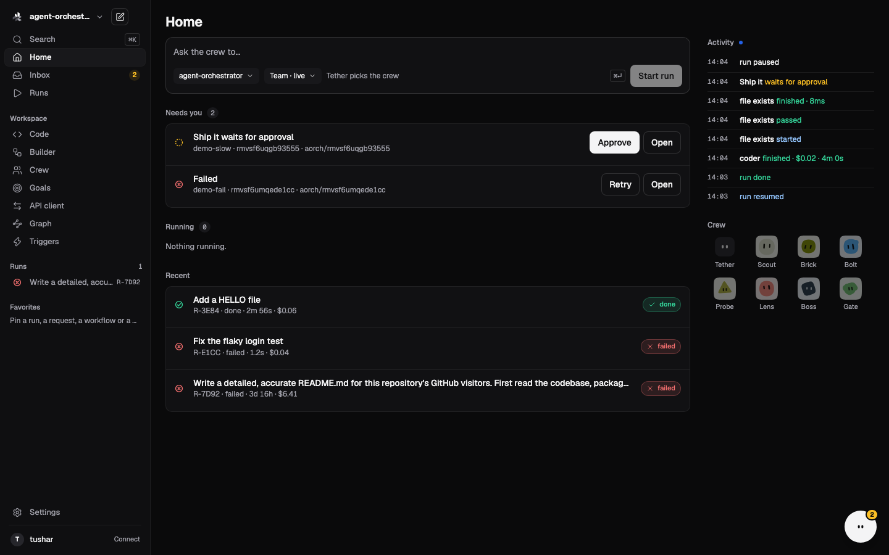

## Contents

- [Why Tether](#why-tether)
- [What you get](#what-you-get)
- [A tour of the app](#a-tour-of-the-app)
- [Quick start](#quick-start)
- [How a run works](#how-a-run-works)
- [Meet the crew](#meet-the-crew)
- [CLI cheat sheet](#cli-cheat-sheet)
- [Safety](#safety)
- [Where things live](#where-things-live)
- [Development](#development)
- [Learn more](#learn-more)

## Why Tether

Coding agents are fast, but leaving them alone on your repo is a gamble. Tether gives them room to work and keeps you in control:

- **Room to run.** Every run gets its own git worktree and branch. Your checkout is never touched.
- **The line holds.** Gates (your test command, a saved API check, a human approval) decide what passes. Never the model's own word.
- **Nothing is lost.** Every run is an append-only event log. Stop, close the app, come back, and resume from the first unfinished step.

## What you get

| | |
|---|---|
| 🧭 **Home and Inbox** | One place for what needs you, what is running and what just finished. Approve or retry inline. |
| 🗺️ **Run view** | A live run graph, the output stream, changed files and one approval bar. Click a step to inspect its output, diff and timeline. |
| 💬 **Tether assistant** (⌘J) | Ask about your runs and code. Answers cite their sources. It can start runs, but only through approval cards. |
| 🧩 **Builder** | Design workflows on a canvas: planner → architect → coder → tests → reviewer → approval, with fix loops. |
| 👥 **Crew** | Link any bot to any agent and model. Import 68 extra agents and their skills from ECC. |
| 🤝 **Team runs** | Give a goal. Tether asks a few questions, writes a plan you approve, then a manager hands the work around. |
| 🎯 **Goals** | A finish check (tests, a command, a number) that keeps starting runs until it passes or the budget runs out. Or just a checklist. |
| 📂 **Code** | Browse and edit your project, search it with ⌘⇧F, and see which runs changed each file. |
| 🔌 **API client** | Saved HTTP requests per project (import cURL, OpenAPI, Postman). Use them as gates or hand them to an agent. |
| 🕸️ **Graph** | A knowledge graph of runs, workflows, roles and notes from your Obsidian-style vault. |
| ⚡ **Triggers** | Start a workflow when a GitHub pull request opens or changes, by webhook or polling. |
| 🧪 **Evolve** | Bots learn from your 👍/👎 and from run outcomes. Tether proposes small, versioned prompt edits. You accept or reject each one. |
| 🧰 **Code Mode** | Agents call tools by writing one small script, run in a local sandbox, instead of making many separate tool calls. |
| 🔐 **Accounts** | Connect GitHub, either by reusing your `gh` login or through a device sign-in. Tokens stay in the macOS Keychain. |

Works with **Claude Code**, **Codex** and **OpenCode**, local servers (**Ollama**, **LM Studio**, **llama.cpp**) and any OpenAI-compatible provider (DeepSeek, OpenAI, OpenRouter, Groq, Together, Fireworks).

## A tour of the app

<table>
  <tr>
    <td width="50%">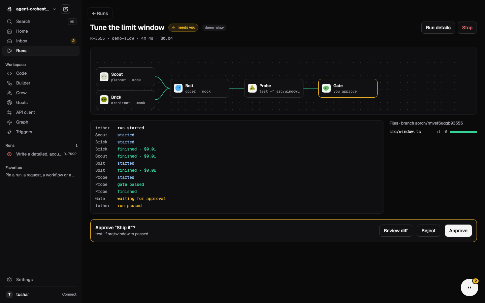<br /><b>Run view.</b> The crew's graph, live output, changed files and one approval bar.</td>
    <td width="50%">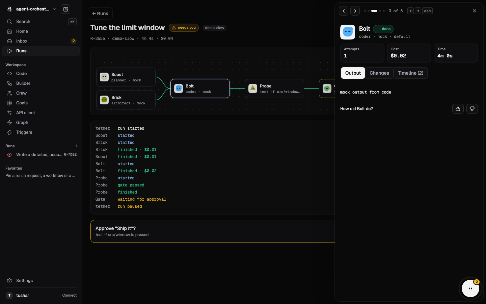<br /><b>Step inspector.</b> Output, changes and timeline for any step, plus 👍/👎.</td>
  </tr>
  <tr>
    <td>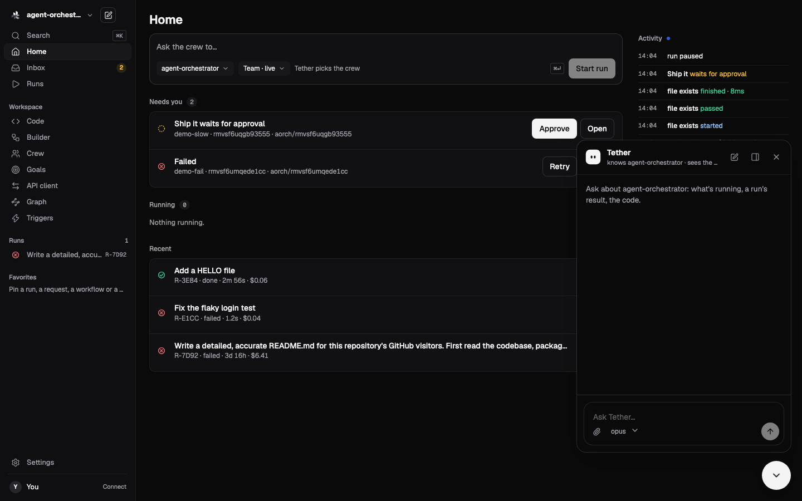<br /><b>Tether assistant (⌘J).</b> Knows your project and runs. Dock it as a side panel.</td>
    <td>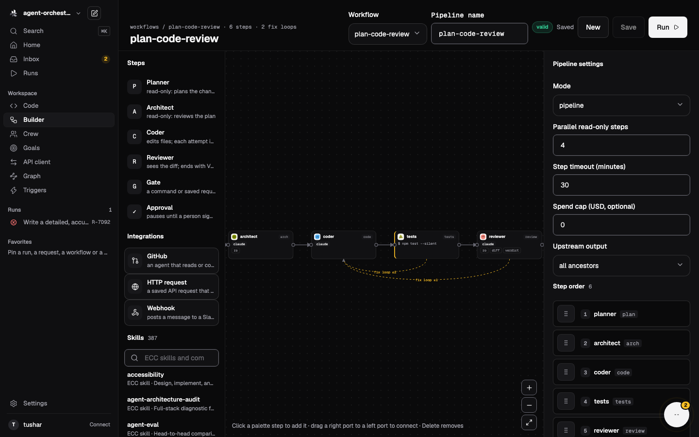<br /><b>Builder.</b> Drag steps, connect ports, add fix loops, skills and integrations.</td>
  </tr>
  <tr>
    <td>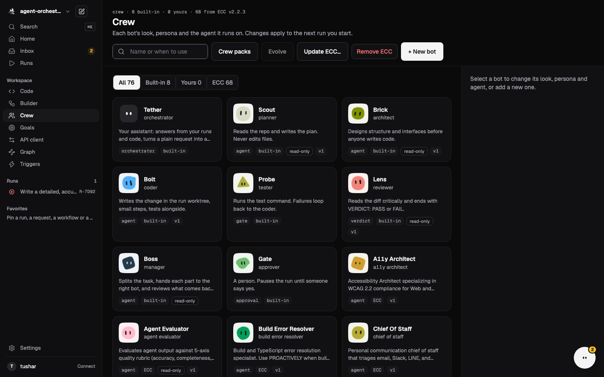<br /><b>Crew.</b> 8 built-in bots and imported ECC agents. Link each one to any model.</td>
    <td>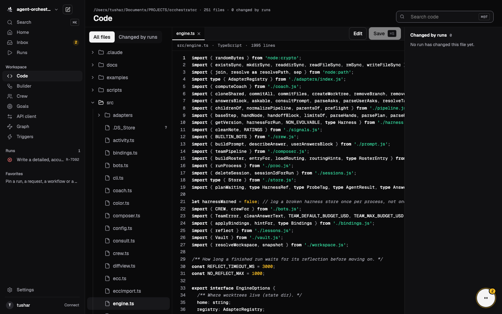<br /><b>Code.</b> Your repo with an editor, code search and "changed by runs".</td>
  </tr>
  <tr>
    <td>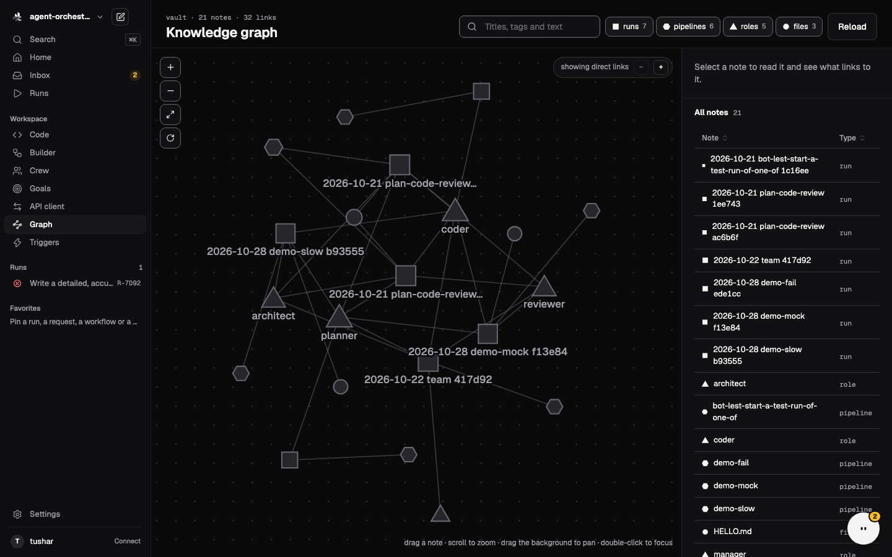<br /><b>Graph.</b> Drag, zoom and search the knowledge graph of your vault.</td>
    <td>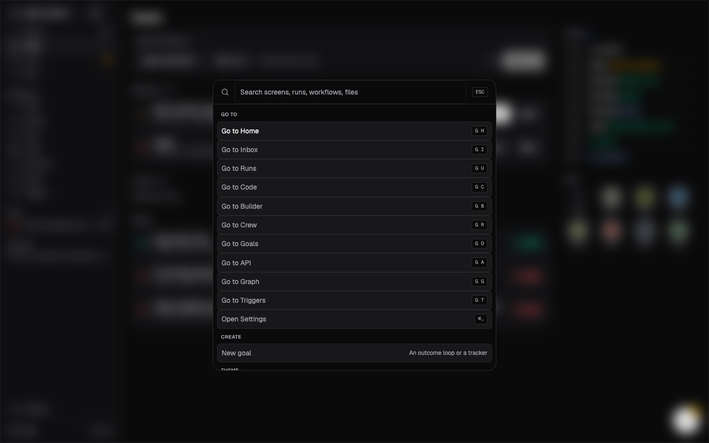<br /><b>⌘K.</b> Jump to any screen, run, workflow or file, or create a goal.</td>
  </tr>
</table>

There is also a full **terminal UI** (`tether tui`) with the same runs, workflows, crew, triggers and chat. See [Terminal UI tips](docs/reference.md#terminal-ui-tips).

## Quick start

You need **Node 22.12+** and **git**. Install whichever agents you want to use (`claude`, `codex`, `opencode`) or run a local model server.

```sh
git clone https://github.com/tusharcora/Tether.git && cd Tether
npm install
npm run build
npm link                # optional: puts `tether` on your PATH (`aorch` still works too)

tether doctor           # which agents and local model servers were found
tether init             # install the example workflows
tether serve            # the web app on http://127.0.0.1:4177 (loopback only)
tether tui              # or the terminal UI
```

Then start something:

```sh
tether team "add rate limiting to the API" --repo ~/code/api      # Tether plans with you, then a team works
tether orchestrate "fix the flaky login test" --repo ~/code/api   # Tether designs a workflow and runs it
tether run plan-code-review --repo ~/code/api --task "add a /health route"   # run a saved workflow
```

### Tether.app (macOS, Apple Silicon)

```sh
npm run app       # builds dist-app/Tether-darwin-arm64/Tether.app (ad-hoc signed)
npm run app:dev   # the app window on the Vite dev server, for UI work
```

The app runs the same server inside itself and shares the same home folder. It is signed for your Mac only, so the first time you open it, right-click **Tether.app → Open**. Open a project with **File → Open Folder… (⌘O)**, by dropping a folder on the window, or with `open -a Tether <dir>`.

## How a run works

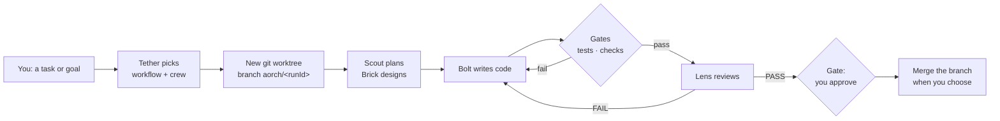

- If a step fails, the **supervisor** retries it, then hands it to a stronger model, then stops and explains what went wrong.
- Bots can **ask each other** (`@ASK`) and **hand off work** (`@HAND`). Workers can ask *you* a question with a recommended answer.
- In **live** mode you see every report and question. In **autonomous** mode Tether answers with the recommended options and reports once at the end.
- Budgets and time limits cover the whole run. Team runs default to a `$5` cap.

## Meet the crew

| Bot | Role | What it does |
|---|---|---|
| **Tether** | assistant | Answers from your runs and code, and turns a request into a workflow or team run. |
| **Scout** | planner | Reads the repo and writes the plan. Read-only. |
| **Brick** | architect | Designs structure and interfaces before anyone writes code. Read-only. |
| **Bolt** | coder | Writes the change in the run's worktree, in small steps, with tests alongside. |
| **Probe** | tester | Runs your test command. Failures loop back to Bolt. |
| **Lens** | reviewer | Reads the diff critically and ends with `VERDICT: PASS` or `FAIL`. |
| **Boss** | manager | Splits a team run into tasks, hands them out and reviews what comes back. |
| **Gate** | approver | That's you. The run pauses until someone says yes. |

Link any bot to any agent and model: `tether bots link coder claude opus`. Add your own bots in the Crew screen.

## CLI cheat sheet

| Command | What it does |
|---|---|
| `tether serve` · `tether tui` | Web app · terminal UI |
| `tether doctor` | Which agent CLIs and local servers are installed |
| `tether team "<goal>" --repo <dir>` | Plan with Tether, approve, let a team work |
| `tether run <workflow> --repo <dir> --task "…"` | Run a saved workflow |
| `tether runs` · `tether show <runId>` | List runs · one run's steps, cost and findings |
| `tether approve <runId> <step>` · `tether resume <runId>` | Approve a paused step · continue a stopped run |
| `tether pr <link>` · `tether triggers …` | Review a GitHub PR · start workflows on PRs automatically |
| `tether evolve <bot>` · `tether harness <bot>` | Propose prompt improvements · see a bot's versions |
| `tether http ls \| run <id> \| send …` | Saved API requests |
| `tether providers add deepseek` | Add an LLM provider (keys stay in env vars) |

`tether --help` lists everything. Exit codes: `0` done · `1` error or stopped · `2` paused for approval.

## Safety

- The server only listens on **loopback** and checks `Host` and `Origin`. Only the GitHub webhook path accepts outside requests, and each one must carry a valid HMAC signature.
- Agent steps run in **their own worktree and branch**. Read-only steps are enforced: any file changes they make are reverted.
- **Gates are your commands.** The test command is never taken from model output.
- File writes in team runs stay **off** until you say yes.
- Credential patterns are redacted from tool calls written to the run log. This is best effort.

## Where things live

| Path | What |
|---|---|
| `~/.aorch/` | Home: run database, worktrees, workflows, crew links, chats, vault. Override with `TETHER_HOME`. |
| `~/.aorch/worktrees/<runId>` | One worktree per run, on branch `aorch/<runId>` |
| `<repo>/.aorch/http/` | Saved API requests for a project (secrets stay in the home folder) |
| macOS Keychain | Connected account tokens |

## Development

```sh
npm test            # vitest
npm run typecheck   # server and web
npm run dev         # server from source
```

The server is TypeScript on Node (`src/`). The web app is React 19 with Tailwind v4 and vendored [beui](https://beui.dev), [bencho](https://bencho.dev) and [aicss](https://aicss.dev) components (`web/src/components/`). The macOS app wraps both in Electron (`src/app/`).

## Learn more

- 📖 **[Full reference](docs/reference.md)**: triggers, team runs, handoffs, Evolve, providers, slash commands
- 🌐 **[Docs site](https://tether.tusharcs0112.workers.dev/docs)**: quick start, gates, crew, Code Mode, security
- 🎨 **[Design mockups](docs/design/)** behind the current app

---

<sub>Tether was called **aorch** before. The `aorch` command, `~/.aorch` and `AORCH_*` variables still work. License: MIT (as declared in `package.json`).</sub>
