<p align="center">
  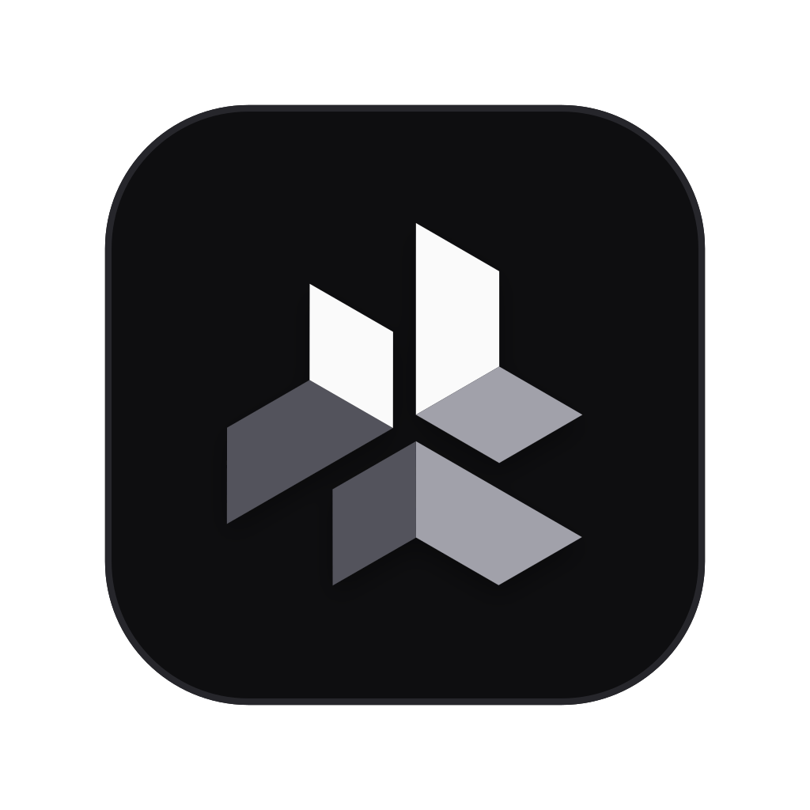
</p>

<h1 align="center">Tether</h1>

<p align="center">
  <b>Let your coding agents run. Never let go.</b><br />
  A local workbench that runs Claude Code, Codex, OpenCode and local models as a crew,<br />
  each run in its own git worktree, checked by gates, and paused for you when it matters.
</p>

<p align="center">
  <a href="https://tether.launchpaged.workers.dev">Website</a> ·
  <a href="https://tether.launchpaged.workers.dev/docs">Docs</a> ·
  <a href="docs/reference.md">Full reference</a>
</p>

<p align="center">
  
  
  
  
</p>

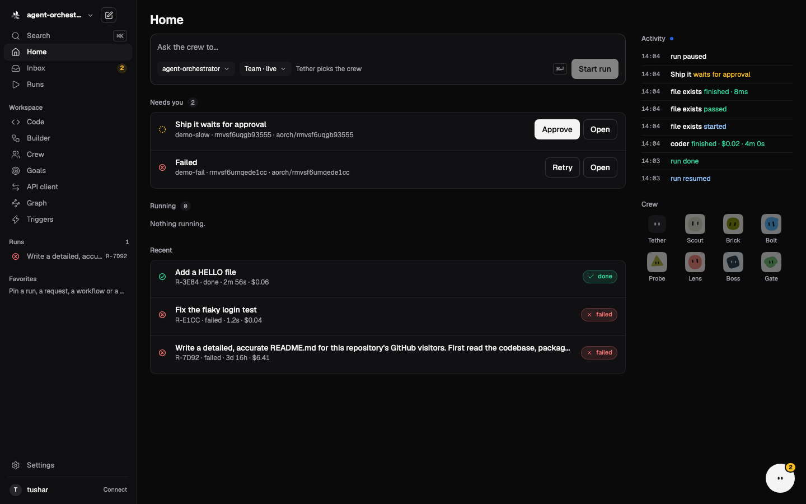

## Contents

- [Why Tether](#why-tether)
- [What you get](#what-you-get)
- [A tour of the app](#a-tour-of-the-app)
- [Quick start](#quick-start)
- [How a run works](#how-a-run-works)
- [Meet the crew](#meet-the-crew)
- [CLI cheat sheet](#cli-cheat-sheet)
- [Safety](#safety)
- [Where things live](#where-things-live)
- [Development](#development)
- [Learn more](#learn-more)

## Why Tether

Coding agents are fast, but leaving them alone on your repo is a gamble. Tether gives them room to work and keeps you in control:

- **Room to run.** Every run gets its own git worktree and branch. Your checkout is never touched.
- **The line holds.** Gates (your test command, a saved API check, a human approval) decide what passes. Never the model's own word.
- **Nothing is lost.** Every run is an append-only event log. Stop, close the app, come back, and resume from the first unfinished step.

## What you get

| | |
|---|---|
| 🧭 **Home and Inbox** | One place for what needs you, what is running and what just finished. Approve or retry inline. |
| 🗺️ **Run view** | A live run graph, the output stream, changed files and one approval bar. Click a step to inspect its output, diff and timeline. |
| 💬 **Tether assistant** (⌘J) | Ask about your runs and code. Answers cite their sources. It can start runs, but only through approval cards. |
| 🧩 **Builder** | Design workflows on a canvas: planner → architect → coder → tests → reviewer → approval, with fix loops. |
| 👥 **Crew** | Link any bot to any agent and model. Import 68 extra agents and their skills from ECC. |
| 🤝 **Team runs** | Give a goal. Tether asks a few questions, writes a plan you approve, then a manager hands the work around. |
| 🎯 **Goals** | A finish check (tests, a command, a number) that keeps starting runs until it passes or the budget runs out. Or just a checklist. |
| 📂 **Code** | Browse and edit your project, search it with ⌘⇧F, and see which runs changed each file. |
| 🔌 **API client** | Saved HTTP requests per project (import cURL, OpenAPI, Postman). Use them as gates or hand them to an agent. |
| 🕸️ **Graph** | A knowledge graph of runs, workflows, roles and notes from your Obsidian-style vault. |
| ⚡ **Triggers** | Start a workflow when a GitHub pull request opens or changes, by webhook or polling. |
| 🧪 **Evolve** | Bots learn from your 👍/👎 and from run outcomes. Tether proposes small, versioned prompt edits. You accept or reject each one. |
| 🧰 **Code Mode** | Agents call tools by writing one small script, run in a local sandbox, instead of making many separate tool calls. |
| 🔐 **Accounts** | Connect GitHub, either by reusing your `gh` login or through a device sign-in. Tokens stay in the macOS Keychain. |

Works with **Claude Code**, **Codex** and **OpenCode**, local servers (**Ollama**, **LM Studio**, **llama.cpp**) and any OpenAI-compatible provider (DeepSeek, OpenAI, OpenRouter, NVIDIA, Groq, Together, Fireworks).

## A tour of the app

<table>
  <tr>
    <td width="50%">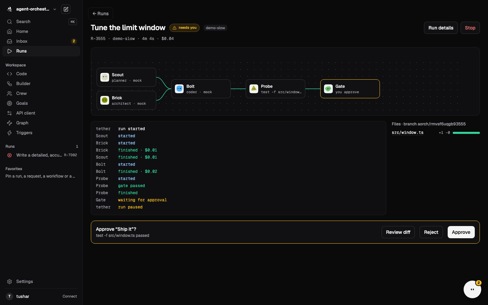<br /><b>Run view.</b> The crew's graph, live output, changed files and one approval bar.</td>
    <td width="50%">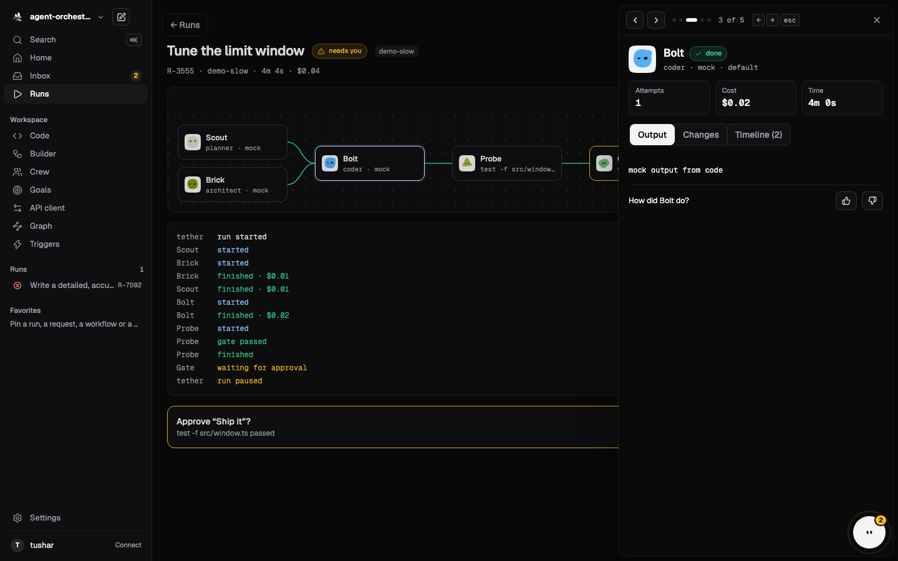<br /><b>Step inspector.</b> Output, changes and timeline for any step, plus 👍/👎.</td>
  </tr>
  <tr>
    <td>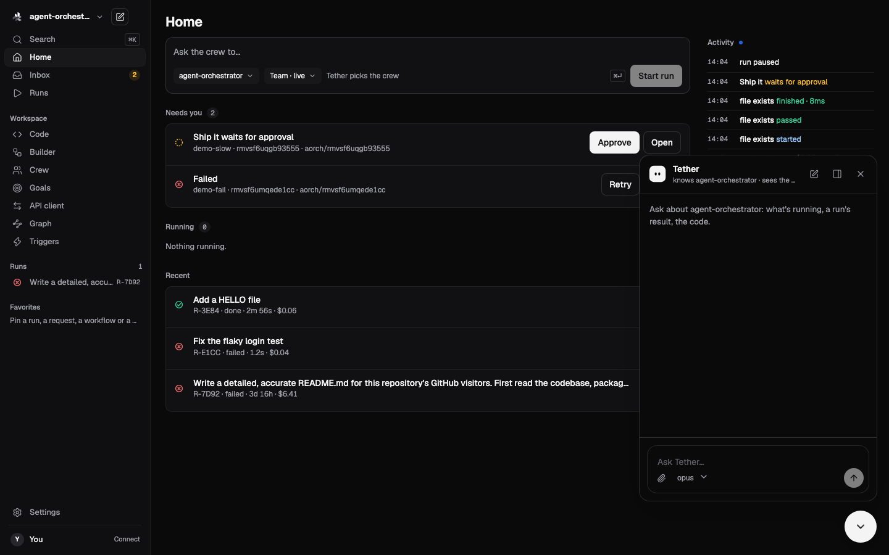<br /><b>Tether assistant (⌘J).</b> Knows your project and runs. Dock it as a side panel.</td>
    <td>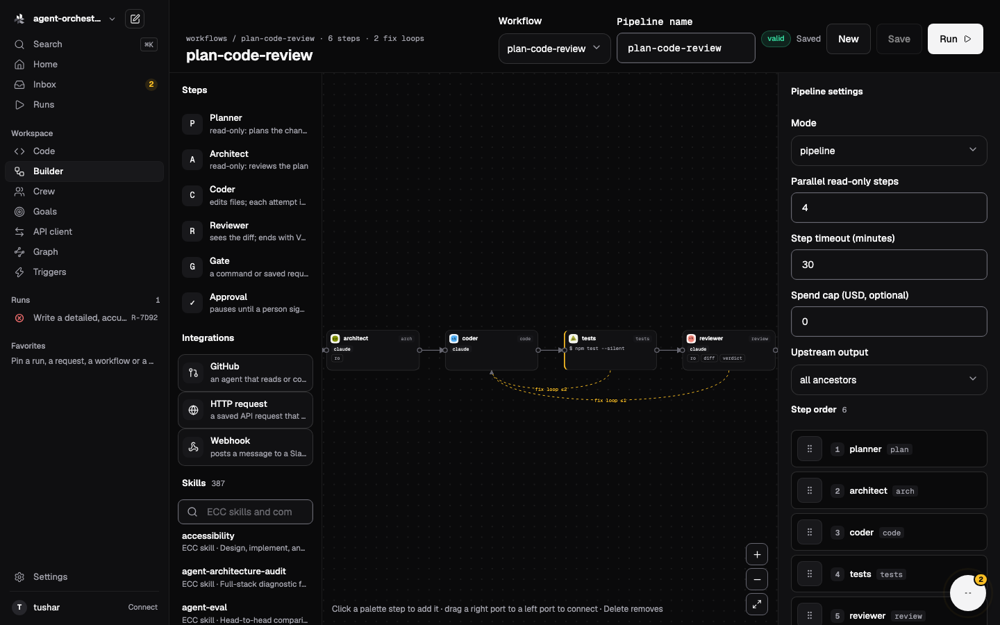<br /><b>Builder.</b> Drag steps, connect ports, add fix loops, skills and integrations.</td>
  </tr>
  <tr>
    <td>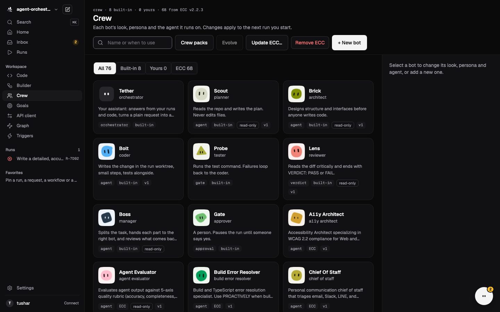<br /><b>Crew.</b> 8 built-in bots and imported ECC agents. Link each one to any model.</td>
    <td>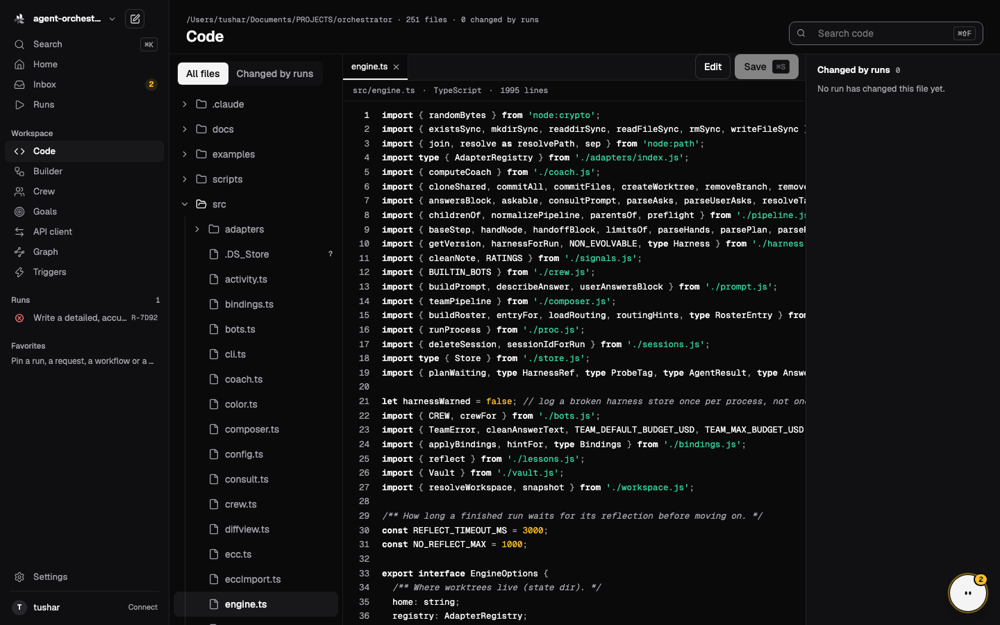<br /><b>Code.</b> Your repo with an editor, code search and "changed by runs".</td>
  </tr>
  <tr>
    <td>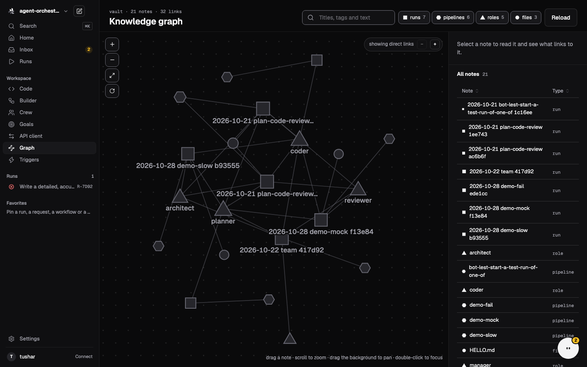<br /><b>Graph.</b> Drag, zoom and search the knowledge graph of your vault.</td>
    <td>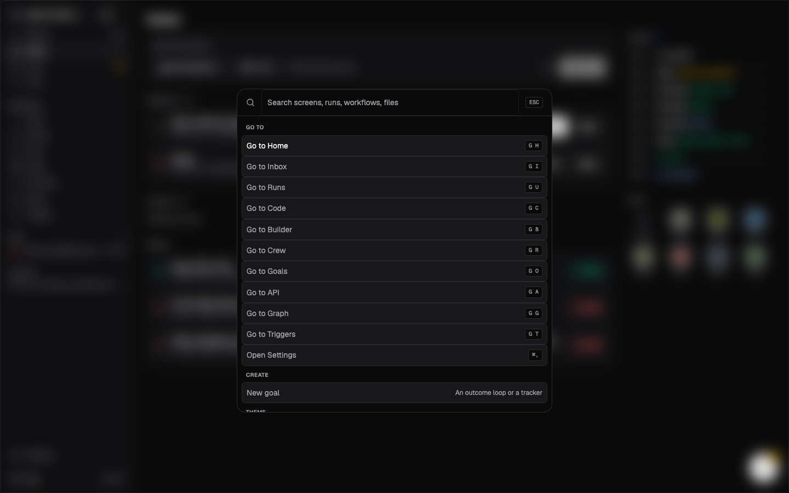<br /><b>⌘K.</b> Jump to any screen, run, workflow or file, or create a goal.</td>
  </tr>
</table>

There is also a full **terminal UI** (`tether tui`) with the same runs, workflows, crew, triggers and chat. See [Terminal UI tips](docs/reference.md#terminal-ui-tips).

## Quick start

You need **Node 22.12+** and **git**. Install whichever agents you want to use (`claude`, `codex`, `opencode`) or run a local model server.

```sh
git clone https://github.com/tusharcora/Tether.git && cd Tether
npm install
npm run build
npm link                # optional: puts `tether` on your PATH (`aorch` still works too)

tether doctor           # which agents and local model servers were found
tether init             # install the example workflows
tether serve            # the web app on http://127.0.0.1:4177 (loopback only)
tether tui              # or the terminal UI
```

Then start something:

```sh
tether team "add rate limiting to the API" --repo ~/code/api      # Tether plans with you, then a team works
tether orchestrate "fix the flaky login test" --repo ~/code/api   # Tether designs a workflow and runs it
tether run plan-code-review --repo ~/code/api --task "add a /health route"   # run a saved workflow
```

### Tether.app (macOS, Apple Silicon)

```sh
npm run app       # builds dist-app/Tether-darwin-arm64/Tether.app (ad-hoc signed)
npm run app:dev   # the app window on the Vite dev server, for UI work
```

The app runs the same server inside itself and shares the same home folder. It is signed for your Mac only, so the first time you open it, right-click **Tether.app → Open**. Open a project with **File → Open Folder… (⌘O)**, by dropping a folder on the window, or with `open -a Tether <dir>`.

## How a run works

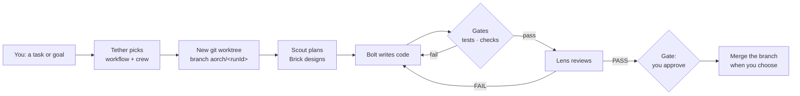

- If a step fails, the **supervisor** retries it, then hands it to a stronger model, then stops and explains what went wrong.
- Bots can **ask each other** (`@ASK`) and **hand off work** (`@HAND`). Workers can ask *you* a question with a recommended answer.
- In **live** mode you see every report and question. In **autonomous** mode Tether answers with the recommended options and reports once at the end.
- Budgets and time limits cover the whole run. Team runs default to a `$5` cap.

### Any folder, git or not

Workflows, squads and tickets work in any folder you register, with or without git. In a folder without git, Tether keeps a hidden history under your Tether home, never in the folder, and a run works in its own worktree, where your files are copied in. Nothing is added to the folder: no `.git`, no `.aorch`, no `.tether`.

- **Putting it in the folder.** When you choose **Put it in the folder**, the run's files are put in the folder, and a run shows how many. If you changed one of those files since the run started, nothing is put in and the file is named. If the folder already has all of the work, nothing is recorded and Tether says so. A fork of work already in the folder brings in only the work that isn't there yet: what the fork changed, plus the work of any run between it and the landed one that was never put in. Whatever else happened in the folder stays as it is. A fork from an earlier step leaves what the parent added after that step; if it changes one of those files, nothing is put in and the file is named.
- **Undo.** Takes back exactly what that run put in, restoring the files as they were, and the ticket goes back to In review so you can ship it again. If you edited a file since, Undo stops, names the file and changes nothing.
- **Left out.** Files over 25 MB, and `node_modules`, `.venv`, `venv`, `__pycache__` and `.DS_Store` at any depth, are not copied into the history. A run sees them linked to the real folder, so a change it makes to them lands in the folder at once and Undo can't reverse it. A git repo inside the folder is linked the same way. A run shows a notice naming everything linked.
- **Refused.** A folder is refused if it is `/`, your home folder, a folder that holds Tether's own home, or has over 100,000 files. Pick a project folder inside it.
- **A git repo's uncommitted work.** In a real repo, a run starts from your files as they are, uncommitted and untracked ones included, so it sees what you see. Tether keeps them in one commit on the run's local `aorch/<run>` branch. They don't ship: a run goes out as `aorch/<run>-pr`, with that commit taken out, and a fork or a run started from another run goes out the same way. If the work depends on those files, shipping stops and asks you to commit them first. If an agent rewrote that commit, or the files would go out anyway, shipping stops and pushes nothing. Shipping again replaces the run's own `aorch/<run>-pr` branch on the remote; no other branch is ever forced. The local branch still holds them, so `git push --all` or `git push --mirror` would publish them. Push branches by name.
- **A repo at your home folder.** A `.git` at your home folder or `/`, such as a dotfiles repo, doesn't count. A folder under it is treated as a folder without git. Your home folder itself is refused.
- **Not yet.** Saving an API request or running `workspace init` still writes `.aorch` into the folder. The history is never pruned.

### Agents do the work from chat

Ask in chat and Tether answers with a **route card**: Do it myself, Make a ticket, Run a workflow or Send a team, with a rough cost ("about 8k tokens") on each and one recommended. A chat turn itself never edits files or runs commands; the card does.

- **Trust this folder?** The first time a card would start work in a folder, Tether asks. "Agents can run commands here, like tests and installs. Undo restores files, but it can't reverse everything a command does. Some things always stop and ask first. Files in a downloaded project can try to steer an agent, so only trust folders you know." A yes holds for that folder and every agent. **Not now** does this one job without commands, saves nothing, and the next card asks again. **Settings → Trusted folders** lists your projects not yet asked about, with a **Trust** button that shows the same words first, and withdraws a yes.
- **What commands may do.** In a trusted folder an agent can run tests, installs and the like. Refused even then: `sudo` and system settings; `git push`, merges and history rewrites; anything acting outside the folder; anything that publishes, sends or spends; `aorch evolve` and `harness ... rollback`. A command is stopped for 120 seconds of running and its output is cut to the last 20,000 characters. In a folder you refused, or on a job you said Not now to, nothing runs and the agent says "not checked".
- **Where it ends.** In a folder without git, Do it myself works on a hidden copy and lands by itself when it finishes; Undo takes it back. In a real git repo it works in a worktree and ends on the usual Merge or Open PR choice. Each job starts fresh, not from the chat's session.

Limits, plainly:

- Codex keeps its own shell, outside the command rule, sandboxed to its folder. OpenCode and custom CLI agents need a trusted folder: in one you refused or haven't been asked about, they don't start until you trust it.
- Claude's process gets no secrets from Tether's environment. Cloud keys reach it only in Bedrock, Vertex or Foundry mode, set in the shell Tether starts from; a mode set only in Claude's `settings.json` `env` isn't seen, so cloud keys are kept out in that setup.
- The command rule matches text. It stops mistakes, not a hostile project.
- A yes rests on the folder's device, inode and birth time, and a no on device and inode alone. On a filesystem with no real birth time a yes rests on those two as well, so on Linux a folder recreated at the same path can keep either answer.
- A folder you refused runs no gates, setup or checks, and neither does a job you said Not now to, until the folder is trusted: it stops and says so, and resuming after a yes picks it up. Not now saves nothing, so a folder counts as refused only through a saved no: an earlier version's Not now, or `PUT /api/trust`. **Ask again** in Settings clears one.
- A folder you were never asked about keeps today's gates, setup and checks for runs started outside chat, but Claude has no Bash there, so a workflow that ran `npm test` through it now says "not checked". Trust the folder in Settings to give it back.
- Work under ignored paths and case or Unicode renames land. Changes in an ignored folder land whole or not at all: past 25 MB for a file or 100,000 files, none of that step's changes there land, and the folders are named. Outside ignored paths, a file over 25 MB stays out, and a file the step removed stays too, named, in case it moved there.
- Landing a one-file change takes about a minute at 50,000 files and about 4 minutes at 100,000 on macOS. That predates this branch.
- Preview in a folder that isn't trusted asks "Trust this folder?" first. Terminal still runs on a click in a refused folder.
- A card says "not checked" only while no check has run; once one passes, the line goes.
- Tests made through the shared helper clean up their temp folders and no longer touch the real checkout. Old leftovers (many in the temp folder, 50 stray worktrees) stay until the owner clears them.
- Claude's command check is a hook and needs a recent Claude Code: `onFailure` was added in 2.1.295. On an older one the hook may be dropped while Bash stays allowed.

## Meet the crew

| Bot | Role | What it does |
|---|---|---|
| **Tether** | assistant | Answers from your runs and code, and turns a request into a workflow or team run. |
| **Scout** | planner | Reads the repo and writes the plan. Read-only. |
| **Brick** | architect | Designs structure and interfaces before anyone writes code. Read-only. |
| **Bolt** | coder | Writes the change in the run's worktree, in small steps, with tests alongside. |
| **Probe** | tester | Runs your test command. Failures loop back to Bolt. |
| **Lens** | reviewer | Reads the diff critically and ends with `VERDICT: PASS` or `FAIL`. |
| **Boss** | manager | Splits a team run into tasks, hands them out and reviews what comes back. |
| **Gate** | approver | That's you. The run pauses until someone says yes. |

Link any bot to any agent and model: `tether bots link coder claude opus`. Add your own bots in the Crew screen.

## CLI cheat sheet

| Command | What it does |
|---|---|
| `tether serve` · `tether tui` | Web app · terminal UI |
| `tether doctor` | Which agent CLIs and local servers are installed |
| `tether team "<goal>" --repo <dir>` | Plan with Tether, approve, let a team work |
| `tether run <workflow> --repo <dir> --task "…"` | Run a saved workflow |
| `tether runs` · `tether show <runId>` | List runs · one run's steps, cost and findings |
| `tether approve <runId> <step>` · `tether resume <runId>` | Approve a paused step · continue a stopped run |
| `tether pr <link>` · `tether triggers …` | Review a GitHub PR · start workflows on PRs automatically |
| `tether evolve <bot>` · `tether harness <bot>` | Propose prompt improvements · see a bot's versions |
| `tether http ls \| run <id> \| send …` | Saved API requests |
| `tether providers add deepseek` | Add an LLM provider (keys stay in env vars) |

`tether --help` lists everything. Exit codes: `0` done · `1` error or stopped · `2` paused for approval.

## Safety

- The server only listens on **loopback** and checks `Host` and `Origin`. Only the GitHub webhook path accepts outside requests, and each one must carry a valid HMAC signature.
- Agent steps run in **their own worktree and branch**. Read-only steps are enforced: any file changes they make are reverted.
- **Gates are your commands.** The test command is never taken from model output.
- File writes in team runs stay **off** until you say yes.
- Credential patterns are redacted from tool calls written to the run log. This is best effort.

## Where things live

| Path | What |
|---|---|
| `~/.aorch/` | Home: run database, worktrees, workflows, crew links, chats, vault. Override with `TETHER_HOME`. |
| `~/.aorch/worktrees/<runId>` | One worktree per run, on branch `aorch/<runId>` |
| `<repo>/.aorch/http/` | Saved API requests for a project (secrets stay in the home folder) |
| macOS Keychain | Connected account tokens |

## Development

```sh
npm test            # vitest
npm run typecheck   # server and web
npm run dev         # server from source
```

The server is TypeScript on Node (`src/`). The web app is React 19 with Tailwind v4 and vendored [beui](https://beui.dev), [bencho](https://bencho.dev) and [aicss](https://aicss.dev) components (`web/src/components/`). The macOS app wraps both in Electron (`src/app/`).

## Learn more

- 📖 **[Full reference](docs/reference.md)**: triggers, team runs, handoffs, Evolve, providers, slash commands
- 🌐 **[Docs site](https://tether.tusharcs0112.workers.dev/docs)**: quick start, gates, crew, Code Mode, security
- 🎨 **[Design mockups](docs/design/)** behind the current app

---

<sub>Tether was called **aorch** before. The `aorch` command, `~/.aorch` and `AORCH_*` variables still work. License: MIT (as declared in `package.json`).</sub>
